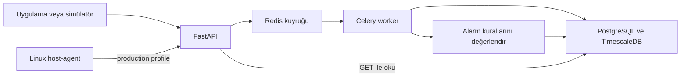

# Observability Platform

FastAPI ile log ve metrik toplayan, Redis/Celery ile arka planda işleyen ve PostgreSQL/TimescaleDB üzerinde saklayan staj projesi. Bu sürüm filtreleme ve sistem içi alarm motorunu içerir.

## Mimari



## Tüm sistemi Docker ile çalıştırma

API, React paneli, worker, Redis ve veritabanı birlikte çalışabilir. Docker Desktop Linux engine açık, `.env` içindeki veritabanı ve erişim bilgileri hazır olmalıdır. İlk kez kuruluyorsa aşağıdaki geliştirme bölümündeki 1 ve 2 numaralı adımlarla `.env` ve erişim bilgileri hazırlanır. Mevcut `.env` dosyasının üzerine örnek dosya kopyalanmaz.

```powershell
docker compose up -d --build --wait --wait-timeout 180
docker compose ps
```

Panel: http://127.0.0.1:8080/ . Mevcut `PANEL_USERNAME` ve `PANEL_PASSWORD` ile giriş yapılır. Giriş yaptıktan sonra Swagger: http://127.0.0.1:8080/api/docs . Veri gönderen araçların API adresi `http://127.0.0.1:8080/api` olur.

Bu düzende `web` servisi React'in derlenmiş dosyalarını Nginx ile sunar; `/api/` isteklerini yalnızca Docker ağı içinde erişilen FastAPI servisine yönlendirir. `API_ROOT_PATH=/api`, Swagger'ın belge ve deneme isteklerini aynı adrese göndermesini sağlar. SSE için proxy tamponlama kapalıdır. Nginx, API'nin adresi konteyner yeniden oluşturulunca değişirse Docker DNS üzerinden yeniden çözer. API ve worker aynı kök Dockerfile'ı kullanır; panelin ayrı Dockerfile'ı Node ile derleme yapıp yalnızca statik çıktıyı Nginx imajına kopyalar. İmajların içine `.env` veya erişim şifreleri kopyalanmaz.

```powershell
# Son kayıtları göster; şifreleri veya oturum çerezlerini paylaşmayın.
docker compose logs --tail=30 api worker web
# Durdur; veriler Docker volume'larında kalır.
docker compose stop
# Kod güncellemesinden sonra imajları tekrar oluştur ve başlat.
docker compose up -d --build --wait --wait-timeout 180
```

`db-init` başarıyla tamamlanıp kapanır. API healthcheck'i işlemin yanıt verdiğini, web healthcheck'i Nginx'i kontrol eder; DB/Redis için girişten sonra panel bağlantı kontrolü kullanılır. Worker'ın çalışması ayrıca görev sonucu ile doğrulanır. `restart: unless-stopped` uzun çalışan servisleri yeniden başlatır; uygulama hatalarını veya disk kaybını önlemez. Kalıcı veriler için ayrıca yedek alınmalıdır. `docker compose down -v` veritabanı ve Redis volume'larını siler; normal durdurma için kullanılmaz.

Varsayılan panel bağlantısı yalnızca bu bilgisayara açıktır. `.env` içindeki `PANEL_HTTP_PORT` değiştirilirse `DOCKER_PANEL_ALLOWED_ORIGINS` de aynı portu içermelidir. `PANEL_ALLOWED_ORIGINS` Windows/Vite geliştirme içindir; Docker API'si `DOCKER_PANEL_ALLOWED_ORIGINS` kullanır. Redis ve veritabanı geliştirme araçları için yalnızca `127.0.0.1` üzerinde erişilebilir; API'nin ayrı yayımlanan portu yoktur. Proxy'nin ilettiği istemci adresi API tarafından güvenilir kabul edildiğinden API doğrudan internete açılmamalıdır.

Bu komut yerel geliştirme içindir; host-agent başlatmaz. Linux sunucusunda production servisleri (HTTPS geçidi ve host-agent) açmak için `.env` hazırlandıktan sonra `docker compose --profile production up -d --build` kullanılır. Production profili Linux ana makinenin `/proc` ve `/sys` alanlarını salt okunur bağlar. Yayındaki örnek: https://artersoft-monitor-omer.spaincentral.cloudapp.azure.com. Agent ölçüm sınırları aşağıdaki "Gerçek makine ölçümleri" bölümünde açıklanmıştır. HTTP üzerinde `SESSION_COOKIE_SECURE=true` kullanılırsa tarayıcı oturumu göndermez.

## Python ve Vite ile geliştirme

Docker Desktop Linux engine açık olmalıdır. API bilgisayarda Python ile, worker Linux konteynerinde çalışır. Python 3.13 veya 3.14 kullanılabilir; worker image Python 3.13 kullanır.

1. Proje klasöründe sanal ortamı ve paketleri hazırlayın:

```powershell
python -m venv .venv
.\.venv\Scripts\python.exe -m pip install -r requirements.txt
```

2. `.env.example` dosyasını `.env` olarak kopyalayın, kullanıcı/veritabanı bilgilerini ve parolayı belirleyin. Mevcut `.env` varsa onu kullanın. `.env` Git'e gönderilmez.

Panel ve uygulama erişim bilgilerini hazırlayın (mevcut dolu alanlar korunur):

```powershell
.\.venv\Scripts\python.exe scripts/setup_access.py
# Alternatif: şifre sorulmadan rastgele şifre ve anahtar üretir.
# .\.venv\Scripts\python.exe scripts/setup_access.py --generate
```

Tek yönetici hesabı `.env` içindeki `PANEL_USERNAME` / `PANEL_PASSWORD` ile tanımlanır. Şifre en az 16 karakterdir; rastgele üretimde değer `.env` dosyasından okunur. `INGEST_API_KEY` ayrı bir uygulama anahtarıdır. Bu değerler gizlidir; rapora, ekran görüntüsüne veya GitHub'a eklemeyin. `.env` hem Git hem Docker build bağlamından dışlanır. İnternette yayınlamada sunucunun gizli ortam ayarları kullanılacaktır.

3. Veritabanı, kuyruk ve worker'ı açın:

```powershell
docker compose up -d --build --wait worker
```

`db-init` servisi şemayı ve alarm migration'ını bir transaction içinde uygular, sonra başarıyla kapanır. Bu normaldir. Scriptler yeniden çalıştırılabilir; mevcut kayıtlar korunur. Volume içinde önceden kurulmuş veritabanının parolası `.env` değiştirilerek otomatik değişmez.

4. API'yi ayrı terminalde başlatın:

```powershell
.\.venv\Scripts\python.exe -m uvicorn main:app --reload --timeout-graceful-shutdown 3
```

Panel: http://127.0.0.1:5173/ (frontend bölümündeki komutla açılır). Önce giriş yapın.

Swagger: http://127.0.0.1:8000/docs (aynı tarayıcı ve aynı `127.0.0.1` ana makinesindeki panel oturumu gerekir). `localhost` ve `127.0.0.1` farklı çerez kapsamlarıdır; adresleri karıştırmayın.

- `GET /health`: API süreci çalışıyor mu?
- `GET /ready`: Veritabanı şeması ve Redis erişilebilir mi? Worker sağlığını ölçmez.
- Worker mesajları: `docker compose logs --tail=40 worker`
- Kod değiştiğinde worker için yeniden `--build` gerekir; API `--reload` ile yenilenir.
- `--timeout-graceful-shutdown 3`, geliştirme sırasında açık SSE bağlantılarının yeniden başlatmayı sınırsız bekletmesini önler. API yeniden açılırken panel kısa süre yeniden bağlanma durumu gösterebilir.

## Giriş ve yetkiler

| Erişim | Yetki |
| --- | --- |
| Girişsiz | Yalnızca `GET /health` ve doğrulanmış giriş isteği |
| Yönetici oturumu | Listeleme, canlı akış, veri gönderimi, alarm/kural yönetimi |
| `Authorization: Bearer <INGEST_API_KEY>` | Dört log/metrik POST ucu, `GET /tasks/{id}` ve `GET /ready` |

Veri gönderim anahtarı logları/metrikleri okuyamaz, SSE açamaz veya kural yönetemez. Bu sürüm tek yönetici ve tek ortak uygulama anahtarı kullanır; kullanıcı kaydı, kullanıcı bazlı roller ve servis başına ayrı anahtar bulunmaz.

`POST /auth/login`, JSON kullanıcı adı/şifre ve `X-Requested-With: observability` başlığı alır. Başarılı girişte rastgele HttpOnly, SameSite=Strict çerezi verilir. Oturumun kendisi Redis'te, çerez değerinin SHA-256 özetinden türetilmiş anahtar altında sekiz saat tutulur. Panel yalnızca CSRF değerini bellekte saklar; şifre veya oturum belirtecini localStorage'a yazmaz. `GET /auth/session`, giriş yapan kullanıcıyı, csrf_token ve expires_at değerlerini döndürür. Değişiklik isteklerinde çereze ek olarak `X-CSRF-Token` gerekir. Panel bunu otomatik ekler. İzin verilen Origin listesi ayrıca kontrol edilir.

`POST /auth/logout` Redis oturumunu siler ve çerezi kaldırır. Mevcut SSE bağlantıları her döngüde (normalde yaklaşık iki saniyede bir) oturumu tekrar doğrular; geçersiz oturumda auth_expired olayıyla kapanır. Oturum Redis'ine erişilemiyorsa yeni veri bildirimi yapılmaz. Panel, oturum süresi dolduğunda veya 401/auth_expired aldığında giriş ekranına döner. Oturum/erişim servisi erişilemezse korunan isteklere 503 döner; giriş kontrolü atlanmaz.

Aynı IP'den 60 saniyede en fazla 10 giriş denemesi yapılabilir; başarılı girişler de bu sayıya dahildir. Sınırda 429 ve Retry-After döner. Ters proxy kurulumunda gerçek istemci IP'si yalnızca güvenilen proxy'den alınmalıdır. Yerel Vite proxy'sinden gelen kullanıcılar aynı IP sınırını paylaşabilir. Giriş gövdesi en fazla 4 KiB'dir.

Swagger'da yönetici değişiklikleri için önce `GET /auth/session` ile csrf_token alınır; Authorize → CsrfToken alanına girilir. Oturum çerezi tarayıcıdan otomatik gider. Uygulama anahtarıyla denemek için IngestKey alanına yalnızca anahtar yazılır. Yönetim işlemlerine dönerken IngestKey temizlenmelidir; gönderilen Bearer kimliği öncelikli değerlendirilir.

Yerel HTTP için `SESSION_COOKIE_SECURE=false` kullanılır. Yayınlamada HTTPS, `SESSION_COOKIE_SECURE=true` ve gerçek site adresini içeren `PANEL_ALLOWED_ORIGINS` gereklidir. Ayar/şifre/anahtar değiştiğinde API yeniden başlatılır; yönetici bilgisi değişmiş eski oturumlar sonraki kontrolde geçersiz olur. API'nin /docs ve /openapi.json yolları da korunur. Yönetici şifresi bu tek hesaplı kurulumda `.env`/gizli ortam değişkenidir; veritabanında bir kullanıcı tablosu veya şifre hash'i saklama sistemi eklenmemiştir.

## Veri gönderme

Tekli uçlara ek olarak `POST /logs/batch` ve `POST /metrics/batch`, JSON dizisi içinde 1-100 kayıt kabul eder. Tüm dizi önce doğrulanır; bir kayıt geçersizse görev kuyruğa alınmaz. Başarılı 202 cevabı `task_id` ve `record_count` içerir. Worker bütün paketi tek transaction içinde kaydeder; kayıtlar ve alarmlar birlikte onaylanır veya geri alınır.

`POST /logs` örneği:

```json
{
  "timestamp": "2026-10-11T12:00:00Z",
  "service": "payment-service",
  "level": "ERROR",
  "message": "Database connection timeout",
  "stack_trace": null,
  "tags": {"environment": "test"}
}
```

`POST /metrics` örneği:

```json
{
  "timestamp": "2026-10-11T12:00:00Z",
  "service": "payment-service",
  "name": "cpu_usage",
  "value": 90,
  "unit": "percent",
  "tags": {"environment": "test"}
}
```

Başarılı gönderim `202` ve `task_id` döndürür. Bu yanıt kuyruğa kabul edildiğini gösterir; kayıt worker tarafından daha sonra oluşturulur. Geçersiz veri `422`, kuyruk/veritabanı bağlantı sorunu `503` döndürür. Parolalar hata yanıtlarına eklenmez.

## Kayıtları okuma

- `GET /logs`: `service`, `level`, `q`, `tags`, `start`, `end`, `limit`, `offset`.
- `GET /metrics`: `service`, `name`, `unit`, `tags`, `start`, `end`, `limit`, `offset`.
- `start` ve `end`, olay zamanı `timestamp` üzerinde dahil sınırlarla filtreler; saat dilimi gerekir.
- `q`, `simple` sözlüğüyle kelime araması yapar; alt metin araması değildir. Örnek: `timeout`.
- `tags` bir JSON nesnesi metnidir; örnek `{"environment":"test"}`. Swagger URL kodlamasını yapar.
- `limit` varsayılan 20, en fazla 200; `offset` 0 ile 100000 arasındadır.
- Cevap: `items`, `limit`, `offset`, `has_more`, `next_offset`.
- Yeni olaylar en üstte gösterilir. Offset ile sayfalama sırasında yeni kayıt gelirse sayfalar kayabilir; canlı ekran için cursor/SSE sonraki aşamada hazırlanacaktır.

## Alarm sistemi

Kurallar yeni kayıt işlenirken anlık değerlendirilir. Bildirimler `alerts` tablosuna kaydedilir ve `GET /alerts` ile okunur.

Varsayılan kurallar:

| Kural | Koşul | Tekrar bekleme süresi |
|---|---|---|
| CPU | `cpu_usage`, `percent`, değer **85'ten büyük** | Her servis için 300 saniye |
| ERROR sayısı | Bir serviste son 300 saniyede **50'den fazla ERROR** | Her servis için 300 saniye |

CPU tam 85 olduğunda ve ERROR sayısı tam 50 olduğunda varsayılan alarm oluşmaz. Log sayısı kuralı API'nin kayıt aldığı `received_at` zamanını kullanır; pencere `(şimdi - süre, şimdi]` şeklindedir. Gecikmiş ve pencere dışında kalan kayıtlar sayılmaz. Metrik kuralı yeni gelen tek ölçümü değerlendirir; geçmiş ortalama hesaplamaz. Birim ve metrik adı tam eşleşmelidir.

### Kural oluşturma ve düzenleme

- `GET /alert-rules`: Kuralları listele (`enabled`, `limit`, `offset`).
- `POST /alert-rules`: Yeni kural oluştur.
- `PATCH /alert-rules/{id}`: Gönderilen alanları değiştir; örneğin `{"enabled":false}`. Değişiklik sonrası bekleme durumu sıfırlanır; yeni ayarlar sonraki kayıtta uygulanır. Önceki kayıtlar yeniden değerlendirilmez.

Metrik kuralı örneği:

```json
{
  "name": "Ödeme yanıt süresi",
  "kind": "metric_threshold",
  "service": "payment-service",
  "metric_name": "response_time",
  "metric_unit": "ms",
  "operator": "gt",
  "threshold": 500,
  "cooldown_seconds": 300,
  "enabled": true
}
```

Log kuralı örneği:

```json
{
  "name": "Ödeme hata yoğunluğu",
  "kind": "log_count",
  "service": "payment-service",
  "level": "ERROR",
  "operator": "gte",
  "threshold": 10,
  "window_seconds": 300,
  "cooldown_seconds": 300,
  "enabled": true
}
```

`service: null` tüm servisleri ayrı ayrı değerlendirir. Metrik karşılaştırmaları: `gt` (>), `gte` (>=), `lt` (<), `lte` (<=). Log sayısında `gt` ve `gte` kullanılır. Aynı isimli kural `409`, bulunmayan kural/alarm `404` döndürür.

### Bildirimleri görme

- `GET /alerts`: `service`, `status`, `rule_id`, `limit`, `offset` ile listele.
- `PATCH /alerts/{id}/acknowledge`: Bildirimi görüldü olarak işaretle. Tekrar çağırmak ilk görülme zamanını değiştirmez.

`acknowledged`, kullanıcının bildirimi gördüğünü belirtir; sistemin normale döndüğünü belirtmez. Otomatik çözülme, e-posta ve webhook bu sürümde yoktur. Ödevdeki sistem içi bildirim seçeneği uygulanmıştır.

## Görevlerin güvenilir işlenmesi

Worker işlemi başarıyla tamamladıktan sonra kuyruk mesajını onaylar. Geçici bağlantı/kilit/havuz hatalarında en fazla 5 tekrar denenir. Aynı Celery görev kimliği yeniden teslim edilirse `processed_tasks` ile çift kayıt/alarm engellenir. Toplu görevdeki kayıt sayısı da saklanır. Kayıtlar, görev kimliği ve alarmlar aynı transaction içinde onaylanır. API'ye yeniden POST göndermek yeni görev oluşturur; istemci tekrarları için idempotency anahtarı henüz yoktur.

`GET /tasks/{task_id}` görevin `PENDING`, `STARTED`, `RETRY`, `SUCCESS` veya `FAILURE` durumunu verir. Sonuçlar Redis'in 1 numaralı veritabanında 24 saat tutulur. `PENDING` sonucu henüz olmayan, süresi dolmuş veya bilinmeyen bir kimliği de temsil edebilir; kimliğin varlığını kanıtlamaz. Başarısız görev kimliği worker loglarında aranabilir. Traceback API cevabına eklenmez. Bu takip, kalıcı bir hata arşivi veya otomatik yeniden oynatma sistemi değildir.

### Bağlantı havuzu

API her sorgu için yeni bağlantı açmak yerine mevcut bağlantıyı ödünç alıp geri verir. Windows API sürecinde varsayılan üst sınır 8, Docker worker alt süreci başına 2 bağlantıdır. Havuz ilk kullanımda oluşturulur, Celery ana sürecinde bağlantı açılmaz. Bağlantı alınmadan önce sağlık kontrolü yapılır; bekleme en fazla 5 saniye ve 32 bekleyen istekle sınırlıdır. Sorgu 10, kilit bekleme 5 saniye ile sınırlıdır. Çok sayıda API/worker süreci açılırsa toplam veritabanı bağlantı bütçesi ayrıca hesaplanmalıdır.

## İşlevsel testler

API, Redis, veritabanı ve worker çalışırken:

```powershell
.\.venv\Scripts\python.exe -m unittest discover -s tests -v
```

Testler kendilerine ait servis ve kuralları oluşturur, sonunda yalnızca bu verileri temizler. Eşik sınırı, log zaman penceresi, filtreleme, sayfalama, kural düzenleme, bildirim onaylama, tekrar teslim ve transaction geri alma kontrol edilir.

Sonuç dosyası oluşturan çalıştırma:

```powershell
.\.venv\Scripts\python.exe scripts/verify_backend.py
```

Yerel kesinti/kurtarma kontrolleri servisleri kısa süre durdurur ve bir worker alt sürecini sonlandırır. Geliştirme ortamında, aktif veri gönderimi yokken çalıştırın:

```powershell
.\.venv\Scripts\python.exe scripts/verify_recovery.py
.\.venv\Scripts\python.exe scripts/verify_outages.py
```

Yerel yük ölçümü (API ve Docker servisleri açık olmalıdır):

```powershell
.\.venv\Scripts\python.exe scripts/load_backend.py --records 1000 --concurrency 8 --batch-size 1 --label tekli-deneme
.\.venv\Scripts\python.exe scripts/load_backend.py --records 1000 --concurrency 8 --batch-size 100 --label paket-deneme

# Yaklaşık bir dakika: 100'lük paketlerle 200 kayıt/saniye hedefi.
.\.venv\Scripts\python.exe scripts/load_backend.py --records 12000 --concurrency 8 --batch-size 100 --rate 200 --label surekli-deneme
```

Ölçüm JSON'ları `test-results/load-{label}.json` içinde tutulur; aynı label tekrar kullanılırsa önceki dosyanın üzerine yazılır. Yarı log, yarı CPU metriği gönderilir. Varsayılan INFO ve CPU %70'tir; `--log-level ERROR --metric-value 90` alarm koşullarını çalıştırır. Bu veri sabit yük içindir; değişken bellek/yanıt süresi üreten görsel demo simülatörü aşağıdadır.

HTTP p50/p95/p99, başarılı **kuyruğa kabul yanıtlarının** gecikmesidir. p95, yanıtların en az %95'inin bu sürede veya daha kısa sürede geldiğini belirtir. `total_seconds`, gönderim başlangıcından bütün kayıtlar ve görev makbuzları DB'de görülene kadar geçen süredir. DB kontrolü gönderim bittikten sonra yapıldığından gerçek son yazma anının üst sınırıdır. `worker_confirmed_seconds`, bütün görevlerin ayrıca SUCCESS olduğunun doğrulandığı süreyi gösterir. Ön kontroller ve temizlik ölçüme dahil değildir.

`--rate 0` beklemeden gönderir. Pozitif rate, HTTP istek sayısını değil kayıt/saniye hedefini belirler. Paket 100 ve hız 200 iken yaklaşık yarım saniyede bir paket planlanır; kayıtlar tek tek eşit aralıklarla gelmez. İstemci aynı anda en fazla concurrency kadar HTTP isteği tutar; worker yavaşsa Redis kuyruğu birikebilir. `--wait-timeout` gönderim sonrasındaki DB/worker beklemesini sınırlar (varsayılan 120 saniye). Bu, bütün çalışmanın toplam süre sınırı değildir; her HTTP isteğinin zaman aşımı 30 saniyedir.

Redis kuyruğu 0,5 saniyede bir örneklenir. Raporlanan tepe değer tüm yerel celery kuyruğundaki **bekleyen görevleri** sayar; çalışan görevleri veya kayıt sayısını saymaz. Kısa sıçramalar kaçabilir; örneklenen tepenin 0 olması hiç kuyruk oluşmadığını kanıtlamaz. Başka simülatör veya istemciyi aynı anda çalıştırmak ölçümü etkiler.

Her çalışma benzersiz bir `qa-load-...` servisi kullanır. Başarı için gönderilen/kaydedilen log ve metrik sayıları, processed_tasks makbuzları ve tüm Celery SUCCESS sonuçları birlikte doğrulanır. Ardından yalnızca o servisin test kayıtları/alarmları ve ilgili görev sonuçları temizlenir; JSON raporu kalır. Başarısız veya sonucu belirsiz çalışmada veri korunur, POST otomatik tekrar edilmez. Ön kontrolde API/DB/Redis/worker hazır değilse gönderime başlanmaz. Başarılı ölçüm ve temizlikte çıkış kodu 0'dır.

Yük üreticisinin altı birim kontrolü ağ bağlantısı açmadan çalışır:

```powershell
.\.venv\Scripts\python.exe -m unittest discover -s tests -p test_load_runner.py -v
```

24 Ekim sonuçları ve sınırları: [yük testi raporu](test-results/load-summary-20261024.md). Bunlar tek bilgisayardaki yerel ölçümlerdir; çok kullanıcılı panel, uzun süreli dayanıklılık veya internet üzerinden üretim kapasitesi kanıtı değildir.

## Panel ve gerçek makine ölçümleri

### React paneli

Panel `frontend` klasöründe React ve Vite ile çalışır. Ekran API, veritabanı ve Redis bağlantısını kontrol eder ve logları filtreleyip 20 kayıtlık sayfalarla gösterir. İlk sayfa SSE ile otomatik yenilenir. Metrik grafiği, seçilen servis ve ölçümün kayıtlı son 100 örneğini canlı günceller. CPU (%), bellek (%), API yanıt süresi (ms), disk okuma hızı (B/s) ve disk yazma hızı (B/s) seçilebilir. API sürelerini görmek için servis alanına `observability-api`, log erişim kayıtlarını görmek için log filtresine aynı servis adını yazın. `artersoft-vm` üzerindeki yanıt süresi sunucunun dahili sağlık kontrolünü; `observability-api` üzerindeki seri gerçek API isteklerinin uygulama süresini gösterir.

Proje kökünden ayrı bir terminalde:

```powershell
cd frontend
npm.cmd ci
npm.cmd run dev
```

Panel: http://127.0.0.1:5173

`Bağlantıyı kontrol et` düğmesi `/api/ready` isteği gönderir. Vite geliştirme sunucusu bunu `http://127.0.0.1:8000/ready` adresine iletir. Backend ve Docker servisleri yukarıdaki komutlarla ayrıca çalıştırılmalıdır. Bu kontrol worker sağlığını ölçmez.

Log tablosu sayfa açıldığında `GET /api/logs?limit=20&offset=0` isteğiyle yüklenir. Zaman, servis, seviye ve mesaj alanlarını gösterir. `Logları yenile` düğmesi mevcut sayfayı tekrar getirir. İstek hataları ile boş sonuç ayrı gösterilir. Saatler tarayıcının yerel saat diliminde gösterilir.

Her satırdaki `Detay` düğmesi tam mesajı, servis/seviyeyi, olay ve platform alım zamanını, JSON etiketlerini ve varsa stack_trace bilgisini açar. Ayrıntılar mevcut liste yanıtından alınır; ek API isteği yapılmaz. Tabloda uzun mesajların üç satırlık önizlemesi gösterilir; detayda tam metin yer alır. Pencere `Kapat` veya Escape ile kapanır. İncelenen kayıt, arka planda yeni loglar gelse de seçildiği hâliyle kalır. Kayıtla hata izi gönderilmemişse bu durum açıklanır.

Servis adı tam eşleşmesi, log seviyesi, mesajda kelime ve başlangıç/bitiş zamanı filtreleri vardır. Alanları değiştirmek sorguyu hemen çalıştırmaz; `Uygula` filtreleri gönderir ve ilk sayfaya döner. `Temizle` filtreleri kaldırır. Tarihler yerel saatten UTC'ye dönüştürülür; başlangıcın bitişten sonra olması isteğe dönüşmeden engellenir. Sunucu da aynı zaman aralığını doğrular.

`Önceki` ve `Sonraki`, API'nin offset/has_more/next_offset bilgilerini kullanır. Sonraki sayfa yoksa düğme pasiftir. İlk sayfa dışındayken SSE bağlantısı kapatılır ve canlı yenileme duraklatılır; `İlk sayfa / canlı` bağlantıyı yeniden açar. Offset sayfaları sabit bir arşiv görüntüsü değildir; arada gelen kayıtlar sayfa sırasını değiştirebilir. API'nin 100000 offset sınırında zaman aralığını daraltma açıklaması gösterilir.

`EventSource('/api/stream/logs?...')` aynı uygulanmış filtrelerle açık bir SSE bağlantısı kurar. Backend, filtreli ilk 20 kaydın ve has_more için bir sonraki kaydın kimlik/zaman listesini iki saniyede bir kontrol eder; değişiklikte `logs_changed` olayı gönderir ve panel listeyi yeniden okur. Dolayısıyla worker'ın kaydı commit etmesinden sonra normal koşullarda yaklaşık iki saniye içinde değişiklik fark edilir. Kuyruk beklemesi ve yavaş bağlantılar bu süreye eklenir. Panelde `Canlı akış açık` veya yeniden bağlanma/DB bekleme durumu gösterilir. Bağlantı geri gelince güncel liste yeniden okunur. Detaylar api-contract.md içinde açıklanmıştır.

Bu sürümde kontrol her açık SSE bağlantısı için yapılır. Çok sayıda izleyici için ortak değişiklik izleyicisi veya bildirim dağıtımı kapasite aşamasında değerlendirilmelidir. SSE geçmişteki her logu sırayla teslim eden kalıcı bir olay kuyruğu değildir; panelin son 20 kayıt görünümünü güncel tutar.

Derleme kontrolü: `npm.cmd run build`. Çıktı `frontend/dist` klasörüne yazılır. `node_modules`, npm önbelleği ve `dist` Git'e eklenmez; `package-lock.json` eklenir. Vite proxy ayarı geliştirme içindir; canlı dağıtımda `/api` yönlendirmesi ayrıca yapılandırılacaktır.

`frontend` klasöründe `npm.cmd test`, sorgu oluşturma, URL kodlama, yerel zaman/UTC dönüşümü, geçersiz aralıklar, sayfa sınırları, metrik serisi/zaman ekseni/birim seçimi, alarm filtreleri, görüldü yanıtı, kural formu, kural kaydetme yanıtları ve oturum/CSRF istemcisini denetler. Yirmi sekiz kontrol vardır; bunlar tarayıcıda görsel/tıklama testleri değildir.

Panelin dosyaları:

- `index.html`: React ekranının yerleşeceği HTML belgesi.
- `src/main.jsx`: React uygulamasını HTML'deki `root` alanına bağlar.
- `src/App.jsx`: Servis kartları ve bağlantı kontrolü.
- `src/LogTable.jsx`: Gerçek API kayıtlarını yükleyen, durumları ve log tablosunu gösteren bileşen.
- `src/LogFilters.jsx`: Uygulanmadan önce düzenlenebilen filtre formu.
- `src/LogDetails.jsx`: Seçilen kaydın tam mesaj, zaman, etiket ve hata izini gösteren detay penceresi.
- `src/MetricsPanel.jsx`: Servis/metrik seçimi, grafik, ölçüm tablosu ve canlı metrik bildirimleri.
- `src/metricQuery.js`: Metrik türleri, sorgu, ölçüm doğrulaması, birim biçimlendirmesi ve zaman ekseni.
- `src/AlertsPanel.jsx`: Alarm listesi, servis/durum filtreleri, sayfalama ve görüldü işlemi.
- `src/alertQuery.js`: Alarm sorguları ve liste/işlem yanıtlarının doğrulanması.
- `src/RulesPanel.jsx`: Kural listesi, sayfalama, oluşturma/düzenleme ve açma/kapatma istekleri.
- `src/RuleEditor.jsx`: Metrik ve log sayısı kuralı formu.
- `src/ruleForm.js`: Kural taslağı, JSON hazırlama, doğrulama ve koşul açıklamaları.
- `src/logQuery.js`: Filtre ve sayfa sorgularını oluşturur; zaman dönüşümü ve aralık kontrolü yapar.
- `../streams.py`: Veritabanındaki liste değişikliklerini SSE ile bildiren backend modülü.
- `src/styles.css`: Koyu tema ve küçük ekran düzeni.
- `vite.config.js`: Geliştirme sunucusu ve API yönlendirmesi.
- `package.json`: Paketler ve çalıştırma komutları.

Faz 3 paneli ve alarm yönetimi tamamlandı. Faz 4 veri simülatörü, yerel yük denemeleri, HTTPS dağıtımı, canlı sentetik kayıt kontrolleri, gerçek VM kaynak ölçümleri ve FastAPI istek ölçümünü içerir. 2 Kasım Azure koşusunda 600 kayıt, 60/60 başarılı görev ve 0 HTTP hatası doğrulanmıştır; worker duraklatma/toparlanma ve CPU eşiği alarmı da denendi. Bu, kısa ve düşük hızlı bir kontrol olduğundan Azure yüksek hacim, uzun süre veya çok izleyicili kapasitesini kanıtlamaz. Dış uygulamaların iş logları/süreleri ve Trace entegrasyonu ayrıca gerekir. Yerel ekran senaryoları ve kapsamları [ekran kontrol raporunda](test-results/ui-summary-20261026.md), canlı yük sonuçları [yük koşusu JSON'unda](test-results/load-azure-live-20261102.json) yer alır.

### Gerçek makine ölçümleri

Production Compose profili `host-agent` adlı ayrı ve ayrıcalıksız Python servisini çalıştırır. Servis Linux ana makinenin `/proc/stat`, `/proc/meminfo` ve `/proc/diskstats` alanlarını okur; `/sys/block` listesini disk bölümlerini ve sanal aygıtları dışarıda tutmak için kullanır. `/proc` ve `/sys` bağları salt okunurdur; container ek Linux yetkileri almaz ve dışarıya port açmaz.

Agent varsayılan olarak 30 saniyede bir CPU yüzdesi, kullanılan bellek yüzdesi ve disk okuma/yazma hızını hesaplar. CPU ve disk hızları ardışık sayaç örnekleri arasındaki farktan türetilir; ilk örnek başlangıç sayacıdır. Ölçümler `POST /metrics/batch` üzerinden mevcut `INGEST_API_KEY` ile gönderilir. API veriyi Redis/Celery/TimescaleDB hattından işler; agent veritabanına doğrudan bağlanmaz. Kayıtlar `service=artersoft-vm`, `tags.source=host-agent` ve `tags.host=artersoft-vm` olarak işaretlenir. Grafikte servis alanına `artersoft-vm` yazın.

`response_time/ms` için iki ayrı servis kullanılır. `artersoft-vm` serisi dahili `/health` kontrolünün gidiş-dönüş süresidir. `observability-api` serisi aşağıdaki API isteği enstrümantasyonundan gelir; rota, yöntem ve HTTP durum etiketleri panelde gösterilir.

`API_REQUEST_TELEMETRY_ENABLED=true` iken API; health/ready, Swagger/OpenAPI, SSE ve log/metrik/alarm/görev listeleme GET'leri dışındaki istekler için yapılandırılmış bir JSON logu ve `response_time/ms` ölçümü üretir. Log ve metrik aynı idempotent Celery göreviyle birlikte yazılır. Gövde, sorgu değerleri, parola ve yetkilendirme başlıkları kaydedilmez. Listeleme istekleri hariçtir; böylece panelin kendi log/metrik sorguları yeni veri üretip canlı akışı döngüye sokmaz. Ölçüm API uygulama katmanını kapsar; TLS, Nginx, tarayıcı veya uçtan uca kullanıcı süresi değildir. Ayar `false` yapılarak kapatılabilir.

Sunucuda agent durumunu kontrol edin:

```bash
sudo docker compose logs --tail=30 host-agent
```

"Metrik paketi kuyruğa alındı" satırı API'nin paketi kabul ettiğini gösterir. Kayıtları `artersoft-vm` servisini seçerek panelde doğrulayın. Varsayılan aralıkla agent günde yaklaşık 14.400 metrik kaydı üretir.

### Canlı metrik grafikleri

Recharts 3.10.1 ile seçilen servisin ölçümleri çizilir. Başlangıç servisi mevcut örneklerin gönderildiği `payment-service`, metrik CPU'dur. Başka servis veya metrik için formu değiştirip Göster'e basılır. Seçimler şöyledir:

| Ekran | API name | API unit | Dikey eksen |
| --- | --- | --- | --- |
| CPU kullanımı | cpu_usage | percent | %0–100 |
| Bellek kullanımı | memory_usage | percent | %0–100 |
| API sağlık yanıt süresi | response_time | ms | 0'dan başlayan otomatik aralık |
| Disk okuma hızı | disk_read_bytes_per_second | bytes_per_second | B/s |
| Disk yazma hızı | disk_write_bytes_per_second | bytes_per_second | B/s |

`GET /metrics` ve `GET /stream/metrics` aynı servis/ad/birim ve `limit=100` değerini kullanır. `metrics_changed` bildirimi yeni GET başlatır. Seçim değişince önceki SSE kapatılır ve önceki serinin yanıtı yeni grafikte gösterilmez. Eksen, özet, bilgi kutusu ve tablo aynı seçili birimi kullanır. Yüzde serilerinde 0–100, diğer serilerde sıfır veya pozitif sonlu sayılar beklenir. Disk hızı ekranda B/s, API içinde `bytes_per_second` birimiyle saklanır. `tags.source=host-agent` olan ölçümlerde panel verinin sunucu ajanından geldiğini belirtir. Simülatör veya elle gönderilen kayıtlar da aynı API yolundan gösterilebilir. Kayıtlı son değer ile ölçüm zamanı birlikte yazılır; veri yoksa sıfır üretilmez. Servis içindeki farklı host etiketleri ayrı serilere ayrılmaz; her nokta bir kayıttır.

Grafik soldan sağa olay zamanına göre ilerler. X eksenindeki aralıklar geçen süreyi, Y ekseni seçilen ölçümün birimini gösterir. Başlangıçta son kayıtlı ölçümden geriye bir saatlik kayıtlar gösterilir; 24 saat veya Tüm kayıtlar seçilebilir. Bu pencere tarayıcının şimdiki saatine değil son ölçümün zamanına dayanır; yüklü son 100 kayıt üzerinde uygulanır. Böylece hafta önceki örnekler yeni birkaç dakikalık ölçümleri tek köşeye sıkıştırmaz. Tüm kayıtlar seçilirse gerçek zaman aralıkları nedeniyle bu sıkışma yine mümkündür. Gösterilen kayıt sayısı ve zaman sınırları yazılır. Saat ve tarih iki satırda gösterilir; kısa aralıkta saniye, çok kısa aralıkta milisaniye de yazılır. Dar ekranda daha az eksen etiketi üretilir. Aynı zamandaki kayıtların tüm değerleri bilgi kutusunda listelenir; veri silinmez veya zamanları kaydırılmaz. Tek ölçümde nokta görünür; seçilen pencerenin veri tablosu klavye ile de açılır. Aradaki çizgi sürekli ölçüm yapıldığı anlamına gelmez. Eski 100 kaydın dışındaki geçmiş grafik üzerinden sayfalanmaz; daha eski kayıt varsa açıklama gösterilir. İstek hatasında eldeki önceki ölçümler hata uyarısıyla kalır; servis değişince önceki servisin verisi gösterilmez. Grafik paketi ayrı JavaScript dosyasıyla yüklenir; servis kartları ve log ekranı bu paketten ayrılmıştır.

SSE, kayıtlar commit edildikten sonra normal koşullarda yaklaşık iki saniyelik kontrol aralığında değişikliği fark eder. İki panel akışı (log ve metrik) ayrı bağlantılar ve ayrı DB kontrolleri kullanır. Yüksek izleyici sayıları için ortak bildirim dağıtımı henüz uygulanmamıştır.

### Alarm bildirimleri

Log tablosunun altında Alarmlar bölümü bulunur. Başlangıçta tüm servislerin `status=open` bildirimlerini gösterir. Bunlar İncelenmedi etiketiyle sunulur; durum, altta yatan sorunun hâlâ sürdüğünü kanıtlamaz. Servis adı tam eşleşmesi ve İncelenmeyenler/Görüldü/Tümü filtreleri Uygula düğmesiyle gönderilir. GET /alerts, 20 kayıtlık sayfaları `triggered_at DESC, id DESC` sırasıyla döndürür. Ekran kuralın alarm oluştuğunda kaydedilmiş adını ve açıklamasını kullanır; mevcut kuralı değiştirerek geçmiş bildirimin anlamını değiştirmez.

İlk sayfa, her GET tamamlandıktan yaklaşık 10 saniye sonra yeni GET ile yenilenir. Bu bölüm SSE kullanmaz. Geçmiş sayfalarda otomatik yenileme durur; İlk sayfa yeniden başlatır. Alarmları yenile manuel kontrol sağlar. Her istek 15 saniyeyle sınırlandırılır. Filtre veya sayfa değişince önceki istek iptal edilir; eski sorgunun satırları yeni görünüm altında gösterilmez. İstek hatasında önceki liste hata uyarısıyla kalabilir. Yeni alarmlar ve işaretlemeler offset sayfalarının sırasını değiştirebilir.

Görüldü işaretle, `PATCH /alerts/{id}/acknowledge` çağırır. Başarılı yanıtın id, status ve acknowledged_at alanları doğrulanır, ardından filtreli liste ve has_more yeniden okunur. İncelenmeyenler filtresinde işaretlenen satır çıkar; Görüldü filtresinde sunucunun kaydettiği zamanla bulunur. İşlem sürerken başka değişiklik yapılmaz ve liste sorgusu durdurulur; sonuç mesajına klavye odağı verilir. Aynı alarmın tekrar işaretlenmesi ilk görülme zamanını değiştirmez. Zaman aşımı/iletişim hatasında işlemin kaydedilmiş olabileceği açıklanır ve liste yeniden okunur. Görüldü, sorunun çözülmesi veya kuralın kapanması değildir; çözülme yaşam döngüsü henüz uygulanmamıştır. Boş sonuç da sistemin hatasız olduğu anlamına gelmez.

### Panelde alarm kuralı yönetimi

Alarmlar bölümünün altında Alarm kuralları bulunur. Kural adı, koşul, servis kapsamı, tekrar bekleme süresi ve etkinlik durumu 20 kayıtlık sayfalarla gösterilir. Kuralları yenile manuel GET /alert-rules isteği gönderir; bu liste otomatik yenilenmez. Yeni kural formu POST /alert-rules, Düzenle formu PATCH /alert-rules/{id} kullanır. Kuralın Kapat/Aç düğmesi yalnızca enabled alanını PATCH eder. Kaydedilen yanıt doğrulandıktan sonra liste yeniden okunur. Yeni kural ilk sayfadan sonra yer alıyorsa Sonraki ile bulunabilir; başarı mesajı kaydedilen kimlik ve adı belirtir.

Metrik eşiğinde ölçüm adı, birimi, karşılaştırma ve eşik girilir. CPU, bellek ve yanıt süresi adları önerilir; başka metrik adı/birimi de yazılabilir. Log sayısında seviye, saniye cinsinden zaman penceresi, gt/gte karşılaştırması ve negatif olmayan tam sayı eşik kullanılır. Form tür değişiminde ilgisiz alanları null gönderir. Metrik kuralında kullanılmayan window_seconds alanı 300 gönderilir. Servis boş bırakılırsa null olur ve her servis ayrı değerlendirilir. Tekrar bekleme 0–86400, log penceresi 1–86400 saniyedir. Boş sayılar sıfıra çevrilmez; sıfır bekleme ve kapalı durum korunur.

Kaydetmek veya kuralı açıp kapatmak o kuralın tekrar bekleme durumunu sıfırlar. Yeni ayarlar sonraki kayıtta uygulanır; geçmiş metrik/loglar topluca yeniden değerlendirilmez. Geçmiş alarm açıklamaları değiştirilmez. Kural silme akışı yoktur; yeni alarm üretimini durdurmak için Kapat kullanılır.

Form açıkken ikinci bir kural düzenlemeye geçilmez; Kaydet veya Vazgeç ile çıkılır. İstekler 15 saniyeyle sınırlıdır. Kaydetme sırasında liste isteği ve diğer değişiklikler durdurulur; zaman aşımında işlem kaydedilmiş olabileceği açıklanır. POST otomatik tekrar edilmez. Aynı isim 409, geçersiz alanlar 422, bulunmayan kural 404 mesajıyla gösterilir; form korunur. Çoklu kullanıcılar arasında düzenleme sürümü/çatışma denetimi henüz yoktur; aynı kuralı eşzamanlı düzenlemek önceki değişikliklerin üzerine yazabilir.

## Veri simülatörü

API, Redis, DB ve worker açıkken; `.env` içindeki INGEST_API_KEY hazırlandıktan sonra proje kökünden ayrı bir terminalde çalıştırılır:

```powershell
.\.venv\Scripts\python.exe scripts/simulate_telemetry.py --duration 60
```

Varsayılan servis `demo-payment`, senaryo `mixed`, tamamlanan turlar arası bekleme 2 saniyedir. Bir servis için her tur bir log ve üç metrik üretir: cpu_usage/percent, memory_usage/percent, response_time/ms. Log ve metrikler iki batch isteğiyle mevcut API'ye gönderilir. Her turdaki Celery görevlerinin SUCCESS olması beklendikten sonra sonraki tur planlanır; worker yavaşsa hız azalır. Terminal kuyruğa kabul edilen ve worker tarafından onaylanan kayıt sayılarını ayrı raporlar. Bu akış görsel demo içindir; kapasite ölçümü değildir.

Panelde metrik servis alanına `demo-payment` yazıp Göster'e basılır; CPU, bellek veya yanıt süresi seçilir. Log filtresinde de aynı servis adı kullanılabilir. Normal modda CPU %15–70, bellek %25–70, yanıt süresi 30–300 ms aralığındadır. Hatalı turda CPU %90–99, bellek %80–96, yanıt süresi 700–1800 ms ve ERROR log/hata izi gönderilir. Bunlar sentetik verilerdir; cihazın gerçek ölçümleri değildir.

Senaryolar:

- `--scenario normal`: Normal INFO/WARN kayıtları ve ölçümler.
- `--scenario incident`: Her turda yüksek ölçümler ve ERROR/hata izi.
- `--scenario mixed`: İlk dört tur normal, her beşinci tur hatalı.

```powershell
# Ctrl+C ile durdurulana kadar çalışır.
.\.venv\Scripts\python.exe scripts/simulate_telemetry.py --duration 0

# İki servis; hata senaryosu; isteğe bağlı JSON çalışma özeti.
.\.venv\Scripts\python.exe scripts/simulate_telemetry.py --services demo-payment demo-orders --scenario incident --duration 30 --report test-results/simulator-run.json
```

`--seed 42` aynı sürüm/ayarlarla rastgele değerleri tekrar üretir; çalışma kimliği ve güncel zamanlar her çalıştırmada değişir. `--interval` 0.2–60 saniye, `--worker-timeout` 1–120 saniye, en fazla 10 farklı servis desteklenir. Her kaydın tags alanında environment=simulation, source=telemetry-simulator, run_id, sequence, scenario ve host bulunur. Zaman her yeni turda UTC olarak alınır. Birden fazla servis kendi metriği ve loguyla üretilir; gerçek uygulamaya bağlantı yapılmaz.

Süre, API hazır olduktan sonraki üretim aralığını sınırlar; başlamış son turun tamamlanması için worker beklenebilir. Her HTTP isteği en fazla 5 saniye, worker bekleme varsayılan 30 saniyedir. Worker hatası veya süre aşımında yeni üretim durur. Ctrl+C üretimi keser; kuyruktaki işler sonra tamamlanabilir. HTTP 202 yalnızca kabul anlamına gelir; confirmed sayıları SUCCESS görevlerine dayanır. Belirsiz POST sonucu otomatik tekrarlanmaz. Raporun unconfirmed_records alanı yalnızca kimliği alınabilmiş fakat sonucu doğrulanamamış görevleri sayar; yanıtı kaybolmuş POST'un sunucuda işlenip işlenmediğini tek başına kanıtlamaz. successful, planlanan süreyi hatasız ve kesintisiz tamamlama durumudur; Ctrl+C çalışmasında interrupted=true ve çıkış kodu 130 olur.

Normal simülasyon kayıtları panelde incelenmek üzere veritabanında kalır; otomatik silinmez. `--report` verilirse JSON özeti belirtilen dosyanın üzerine yazılır. Bellekte yalnızca son 20 görev kimliği tutulur ve raporda recent_task_ids olarak yer alır; uzun çalışmanın tam görev arşivi değildir. Simülatör veritabanına doğrudan bağlanmaz ve kural ayarlarını değiştirmez. Alarm oluşması mevcut etkin kurallara ve tekrar bekleme süresine bağlıdır. Örneğin varsayılan CPU kuralı hatalı turda tetiklenebilir; 50 üzeri ERROR kuralı için pencerede yeterli ERROR birikmesi gerekir.

Simülatör testleri:

```powershell
.\.venv\Scripts\python.exe -m unittest discover -s tests -p test_simulator.py -v
```

Dokuz test API modellerine uygun veri, senaryo/seed, yeni zamanlar, CLI sınırları, worker bekleme/süre aşımı, belirsiz POST'u tekrar etmeme, sınırlı çalışma, eksik uygulama anahtarı ve Ctrl+C davranışını kapsar. Önceki gerçek servis doğrulama özeti test-results/simulator-smoke.json içindedir; bu QA kayıtları temizlenmiştir. Panel için bırakılan kısa demonun özeti test-results/simulator-demo.json içindedir. Yeni erişim anahtarı ve panel oturumuyla gerçek doğrulama test-results/access-proxy-20261024.json içindedir. Yük ölçümleri yukarıdaki ayrı bölümde açıklanır.
