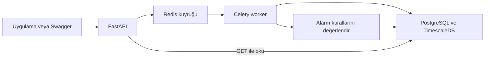

# Observability Platform

FastAPI ile log ve metrik toplayan, Redis/Celery ile arka planda işleyen ve PostgreSQL/TimescaleDB üzerinde saklayan staj projesi. Bu sürüm filtreleme ve sistem içi alarm motorunu içerir.

## Mimari



## Kurulum ve çalıştırma

Docker Desktop Linux engine açık olmalıdır. API bilgisayarda Python ile, worker Linux konteynerinde çalışır. Python 3.13 veya 3.14 kullanılabilir; worker image Python 3.13 kullanır.

1. Proje klasöründe sanal ortamı ve paketleri hazırlayın:

```powershell
python -m venv .venv
.\.venv\Scripts\python.exe -m pip install -r requirements.txt
```

2. `.env.example` dosyasını `.env` olarak kopyalayın, kullanıcı/veritabanı bilgilerini ve parolayı belirleyin. Mevcut `.env` varsa onu kullanın. `.env` Git'e gönderilmez.

3. Veritabanı, kuyruk ve worker'ı açın:

```powershell
docker compose up -d --build --wait worker
```

`db-init` servisi şemayı ve alarm migration'ını bir transaction içinde uygular, sonra başarıyla kapanır. Bu normaldir. Scriptler yeniden çalıştırılabilir; mevcut kayıtlar korunur. Volume içinde önceden kurulmuş veritabanının parolası `.env` değiştirilerek otomatik değişmez.

4. API'yi ayrı terminalde başlatın:

```powershell
.\.venv\Scripts\python.exe -m uvicorn main:app --reload --timeout-graceful-shutdown 3
```

Swagger: http://127.0.0.1:8000/docs

- `GET /health`: API süreci çalışıyor mu?
- `GET /ready`: Veritabanı şeması ve Redis erişilebilir mi? Worker sağlığını ölçmez.
- Worker mesajları: `docker compose logs --tail=40 worker`
- Kod değiştiğinde worker için yeniden `--build` gerekir; API `--reload` ile yenilenir.
- `--timeout-graceful-shutdown 3`, geliştirme sırasında açık SSE bağlantılarının yeniden başlatmayı sınırsız bekletmesini önler. API yeniden açılırken panel kısa süre yeniden bağlanma durumu gösterebilir.

## Veri gönderme

Tekli uçlara ek olarak `POST /logs/batch` ve `POST /metrics/batch`, JSON dizisi içinde 1-100 kayıt kabul eder. Tüm dizi önce doğrulanır; bir kayıt geçersizse görev kuyruğa alınmaz. Başarılı 202 cevabı `task_id` ve `record_count` içerir. Worker bütün paketi tek transaction içinde kaydeder; kayıtlar ve alarmlar birlikte onaylanır veya geri alınır.

`POST /logs` örneği:

```json
{
  "timestamp": "2026-10-11T12:00:00Z",
  "service": "payment-service",
  "level": "ERROR",
  "message": "Database connection timeout",
  "stack_trace": null,
  "tags": {"environment": "test"}
}
```

`POST /metrics` örneği:

```json
{
  "timestamp": "2026-10-11T12:00:00Z",
  "service": "payment-service",
  "name": "cpu_usage",
  "value": 90,
  "unit": "percent",
  "tags": {"environment": "test"}
}
```

Başarılı gönderim `202` ve `task_id` döndürür. Bu yanıt kuyruğa kabul edildiğini gösterir; kayıt worker tarafından daha sonra oluşturulur. Geçersiz veri `422`, kuyruk/veritabanı bağlantı sorunu `503` döndürür. Parolalar hata yanıtlarına eklenmez.

## Kayıtları okuma

- `GET /logs`: `service`, `level`, `q`, `tags`, `start`, `end`, `limit`, `offset`.
- `GET /metrics`: `service`, `name`, `unit`, `tags`, `start`, `end`, `limit`, `offset`.
- `start` ve `end`, olay zamanı `timestamp` üzerinde dahil sınırlarla filtreler; saat dilimi gerekir.
- `q`, `simple` sözlüğüyle kelime araması yapar; alt metin araması değildir. Örnek: `timeout`.
- `tags` bir JSON nesnesi metnidir; örnek `{"environment":"test"}`. Swagger URL kodlamasını yapar.
- `limit` varsayılan 20, en fazla 200; `offset` 0 ile 100000 arasındadır.
- Cevap: `items`, `limit`, `offset`, `has_more`, `next_offset`.
- Yeni olaylar en üstte gösterilir. Offset ile sayfalama sırasında yeni kayıt gelirse sayfalar kayabilir; canlı ekran için cursor/SSE sonraki aşamada hazırlanacaktır.

## Alarm sistemi

Kurallar yeni kayıt işlenirken anlık değerlendirilir. Bildirimler `alerts` tablosuna kaydedilir ve `GET /alerts` ile okunur.

Varsayılan kurallar:

| Kural | Koşul | Tekrar bekleme süresi |
|---|---|---|
| CPU | `cpu_usage`, `percent`, değer **85'ten büyük** | Her servis için 300 saniye |
| ERROR sayısı | Bir serviste son 300 saniyede **50'den fazla ERROR** | Her servis için 300 saniye |

CPU tam 85 olduğunda ve ERROR sayısı tam 50 olduğunda varsayılan alarm oluşmaz. Log sayısı kuralı API'nin kayıt aldığı `received_at` zamanını kullanır; pencere `(şimdi - süre, şimdi]` şeklindedir. Gecikmiş ve pencere dışında kalan kayıtlar sayılmaz. Metrik kuralı yeni gelen tek ölçümü değerlendirir; geçmiş ortalama hesaplamaz. Birim ve metrik adı tam eşleşmelidir.

### Kural oluşturma ve düzenleme

- `GET /alert-rules`: Kuralları listele (`enabled`, `limit`, `offset`).
- `POST /alert-rules`: Yeni kural oluştur.
- `PATCH /alert-rules/{id}`: Gönderilen alanları değiştir; örneğin `{"enabled":false}`. Değişiklik sonrası bekleme durumu sıfırlanır; yeni ayarlar sonraki kayıtta uygulanır. Önceki kayıtlar yeniden değerlendirilmez.

Metrik kuralı örneği:

```json
{
  "name": "Ödeme yanıt süresi",
  "kind": "metric_threshold",
  "service": "payment-service",
  "metric_name": "response_time",
  "metric_unit": "ms",
  "operator": "gt",
  "threshold": 500,
  "cooldown_seconds": 300,
  "enabled": true
}
```

Log kuralı örneği:

```json
{
  "name": "Ödeme hata yoğunluğu",
  "kind": "log_count",
  "service": "payment-service",
  "level": "ERROR",
  "operator": "gte",
  "threshold": 10,
  "window_seconds": 300,
  "cooldown_seconds": 300,
  "enabled": true
}
```

`service: null` tüm servisleri ayrı ayrı değerlendirir. Metrik karşılaştırmaları: `gt` (>), `gte` (>=), `lt` (<), `lte` (<=). Log sayısında `gt` ve `gte` kullanılır. Aynı isimli kural `409`, bulunmayan kural/alarm `404` döndürür.

### Bildirimleri görme

- `GET /alerts`: `service`, `status`, `rule_id`, `limit`, `offset` ile listele.
- `PATCH /alerts/{id}/acknowledge`: Bildirimi görüldü olarak işaretle. Tekrar çağırmak ilk görülme zamanını değiştirmez.

`acknowledged`, kullanıcının bildirimi gördüğünü belirtir; sistemin normale döndüğünü belirtmez. Otomatik çözülme, e-posta ve webhook bu sürümde yoktur. Ödevdeki sistem içi bildirim seçeneği uygulanmıştır.

## Görevlerin güvenilir işlenmesi

Worker işlemi başarıyla tamamladıktan sonra kuyruk mesajını onaylar. Geçici bağlantı/kilit/havuz hatalarında en fazla 5 tekrar denenir. Aynı Celery görev kimliği yeniden teslim edilirse `processed_tasks` ile çift kayıt/alarm engellenir. Toplu görevdeki kayıt sayısı da saklanır. Kayıtlar, görev kimliği ve alarmlar aynı transaction içinde onaylanır. API'ye yeniden POST göndermek yeni görev oluşturur; istemci tekrarları için idempotency anahtarı henüz yoktur.

`GET /tasks/{task_id}` görevin `PENDING`, `STARTED`, `RETRY`, `SUCCESS` veya `FAILURE` durumunu verir. Sonuçlar Redis'in 1 numaralı veritabanında 24 saat tutulur. `PENDING` sonucu henüz olmayan, süresi dolmuş veya bilinmeyen bir kimliği de temsil edebilir; kimliğin varlığını kanıtlamaz. Başarısız görev kimliği worker loglarında aranabilir. Traceback API cevabına eklenmez. Bu takip, kalıcı bir hata arşivi veya otomatik yeniden oynatma sistemi değildir.

### Bağlantı havuzu

API her sorgu için yeni bağlantı açmak yerine mevcut bağlantıyı ödünç alıp geri verir. Windows API sürecinde varsayılan üst sınır 8, Docker worker alt süreci başına 2 bağlantıdır. Havuz ilk kullanımda oluşturulur, Celery ana sürecinde bağlantı açılmaz. Bağlantı alınmadan önce sağlık kontrolü yapılır; bekleme en fazla 5 saniye ve 32 bekleyen istekle sınırlıdır. Sorgu 10, kilit bekleme 5 saniye ile sınırlıdır. Çok sayıda API/worker süreci açılırsa toplam veritabanı bağlantı bütçesi ayrıca hesaplanmalıdır.

## İşlevsel testler

API, Redis, veritabanı ve worker çalışırken:

```powershell
.\.venv\Scripts\python.exe -m unittest discover -s tests -v
```

Testler kendilerine ait servis ve kuralları oluşturur, sonunda yalnızca bu verileri temizler. Eşik sınırı, log zaman penceresi, filtreleme, sayfalama, kural düzenleme, bildirim onaylama, tekrar teslim ve transaction geri alma kontrol edilir.

Sonuç dosyası oluşturan çalıştırma:

```powershell
.\.venv\Scripts\python.exe scripts/verify_backend.py
```

Yerel kesinti/kurtarma kontrolleri servisleri kısa süre durdurur ve bir worker alt sürecini sonlandırır. Geliştirme ortamında, aktif veri gönderimi yokken çalıştırın:

```powershell
.\.venv\Scripts\python.exe scripts/verify_recovery.py
.\.venv\Scripts\python.exe scripts/verify_outages.py
```

Sınırlı yerel yük ölçümü:

```powershell
.\.venv\Scripts\python.exe scripts/load_backend.py --records 1000 --concurrency 8 --batch-size 1 --label pooled
.\.venv\Scripts\python.exe scripts/load_backend.py --records 1000 --concurrency 8 --batch-size 100 --label batch
```

Ölçüm JSON'ları `test-results` içinde tutulur. HTTP gecikmesi kuyruğa kabul cevabının süresidir; bütün kayıtların veritabanına ulaşma süresi ayrıca ölçülür. `--log-level ERROR --metric-value 90` alarm koşullarını da çalıştırır. Bu betik sabit ve sınırlı bir backend ölçümüdür; Faz 4'teki sürekli rastgele veri üreten simülatörün ve daha kapsamlı yük testlerinin yerine geçmez.

## Sonraki aşama

### React paneli

Panel `frontend` klasöründe React ve Vite ile çalışır. Node.js 24 kuruludur. Ekran API, veritabanı ve Redis bağlantısını kontrol eder ve logları filtreleyip 20 kayıtlık sayfalarla gösterir. İlk sayfa SSE ile otomatik yenilenir. Metrik grafikleri henüz eklenmemiştir.

Proje kökünden ayrı bir terminalde:

```powershell
cd frontend
npm.cmd ci
npm.cmd run dev
```

Panel: http://127.0.0.1:5173

`Bağlantıyı kontrol et` düğmesi `/api/ready` isteği gönderir. Vite geliştirme sunucusu bunu `http://127.0.0.1:8000/ready` adresine iletir. Backend ve Docker servisleri yukarıdaki komutlarla ayrıca çalıştırılmalıdır. Bu kontrol worker sağlığını ölçmez.

Log tablosu sayfa açıldığında `GET /api/logs?limit=20&offset=0` isteğiyle yüklenir. Zaman, servis, seviye ve mesaj alanlarını gösterir. `Logları yenile` düğmesi mevcut sayfayı tekrar getirir. İstek hataları ile boş sonuç ayrı gösterilir. Saatler tarayıcının yerel saat diliminde gösterilir.

Her satırdaki `Detay` düğmesi tam mesajı, servis/seviyeyi, olay ve platform alım zamanını, JSON etiketlerini ve varsa stack_trace bilgisini açar. Ayrıntılar mevcut liste yanıtından alınır; ek API isteği yapılmaz. Tabloda uzun mesajların üç satırlık önizlemesi gösterilir; detayda tam metin yer alır. Pencere `Kapat` veya Escape ile kapanır. İncelenen kayıt, arka planda yeni loglar gelse de seçildiği hâliyle kalır. Kayıtla hata izi gönderilmemişse bu durum açıklanır.

Servis adı tam eşleşmesi, log seviyesi, mesajda kelime ve başlangıç/bitiş zamanı filtreleri vardır. Alanları değiştirmek sorguyu hemen çalıştırmaz; `Uygula` filtreleri gönderir ve ilk sayfaya döner. `Temizle` filtreleri kaldırır. Tarihler yerel saatten UTC'ye dönüştürülür; başlangıcın bitişten sonra olması isteğe dönüşmeden engellenir. Sunucu da aynı zaman aralığını doğrular.

`Önceki` ve `Sonraki`, API'nin offset/has_more/next_offset bilgilerini kullanır. Sonraki sayfa yoksa düğme pasiftir. İlk sayfa dışındayken SSE bağlantısı kapatılır ve canlı yenileme duraklatılır; `İlk sayfa / canlı` bağlantıyı yeniden açar. Offset sayfaları sabit bir arşiv görüntüsü değildir; arada gelen kayıtlar sayfa sırasını değiştirebilir. API'nin 100000 offset sınırında zaman aralığını daraltma açıklaması gösterilir.

`EventSource('/api/stream/logs?...')` aynı uygulanmış filtrelerle açık bir SSE bağlantısı kurar. Backend, filtreli ilk 20 kaydın ve has_more için bir sonraki kaydın kimlik/zaman listesini iki saniyede bir kontrol eder; değişiklikte `logs_changed` olayı gönderir ve panel listeyi yeniden okur. Dolayısıyla worker'ın kaydı commit etmesinden sonra normal koşullarda yaklaşık iki saniye içinde değişiklik fark edilir. Kuyruk beklemesi ve yavaş bağlantılar bu süreye eklenir. Panelde `Canlı akış açık` veya yeniden bağlanma/DB bekleme durumu gösterilir. Bağlantı geri gelince güncel liste yeniden okunur. Detaylar api-contract.md içinde açıklanmıştır.

Bu sürümde kontrol her açık SSE bağlantısı için yapılır. Çok sayıda izleyici için ortak değişiklik izleyicisi veya bildirim dağıtımı kapasite aşamasında değerlendirilmelidir. SSE geçmişteki her logu sırayla teslim eden kalıcı bir olay kuyruğu değildir; panelin son 20 kayıt görünümünü güncel tutar.

Derleme kontrolü: `npm.cmd run build`. Çıktı `frontend/dist` klasörüne yazılır. `node_modules`, npm önbelleği ve `dist` Git'e eklenmez; `package-lock.json` eklenir. Vite proxy ayarı geliştirme içindir; canlı dağıtımda `/api` yönlendirmesi ayrıca yapılandırılacaktır.

`frontend` klasöründe `npm.cmd test`, sorgu oluşturma, URL kodlama, yerel zaman/UTC dönüşümü, geçersiz aralıklar ve sayfa sınırlarını denetler. Bunlar tarayıcıda görsel/tıklama testleri değildir.

Panelin dosyaları:

- `index.html`: React ekranının yerleşeceği HTML belgesi.
- `src/main.jsx`: React uygulamasını HTML'deki `root` alanına bağlar.
- `src/App.jsx`: Servis kartları ve bağlantı kontrolü.
- `src/LogTable.jsx`: Gerçek API kayıtlarını yükleyen, durumları ve log tablosunu gösteren bileşen.
- `src/LogFilters.jsx`: Uygulanmadan önce düzenlenebilen filtre formu.
- `src/LogDetails.jsx`: Seçilen kaydın tam mesaj, zaman, etiket ve hata izini gösteren detay penceresi.
- `src/logQuery.js`: Filtre ve sayfa sorgularını oluşturur; zaman dönüşümü ve aralık kontrolü yapar.
- `../streams.py`: Veritabanındaki liste değişikliklerini SSE ile bildiren backend modülü.
- `src/styles.css`: Koyu tema ve küçük ekran düzeni.
- `vite.config.js`: Geliştirme sunucusu ve API yönlendirmesi.
- `package.json`: Paketler ve çalıştırma komutları.

Faz 3'te log akışı, filtreleme, sayfalama ve kayıt detayları eklenmiştir. Metrik grafikleri ve alarm yönetim ekranı; ardından sürekli simülatör, kapsamlı yük testleri, internette yayınlama ve sunum hazırlanacaktır. Yerel ölçümler başka donanım veya üretim ortamında aynı performansın sağlanacağını kanıtlamaz. API bu aşamada yerel geliştirme için hazırlanmıştır; canlıya alma aşamasında kimlik doğrulama ve erişim sınırları eklenecektir.
